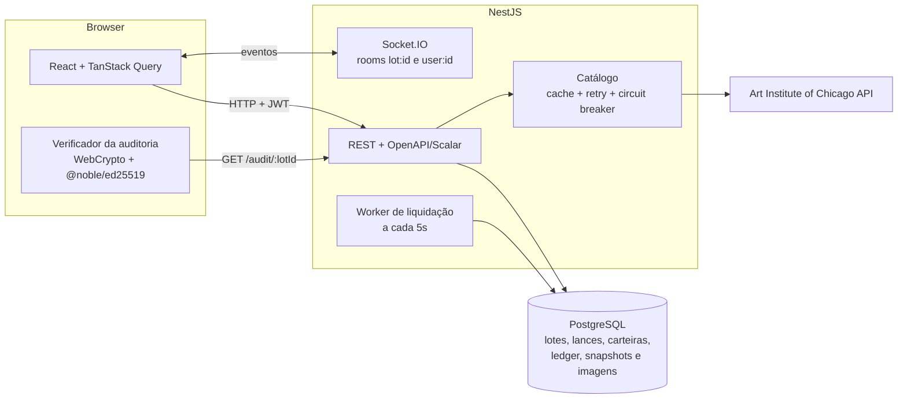

# Pregão · Casa de Leilões

Casa de leilões online de obras em domínio público. O leiloeiro monta lotes a partir do
acervo do Art Institute of Chicago; licitantes depositam saldo simulado, dão lances ao vivo
e, se vencem, recebem um comprovante compartilhável. Qualquer pessoa, sem login, audita o
histórico de lances de um lote e verifica no próprio navegador que ele não foi adulterado.

Teste técnico Elite Dev (Verzel).

- [Deploy e contas de teste](#deploy)
- [Funcionalidades](#funcionalidades)
- [Arquitetura](#arquitetura)
- [Como rodar](#como-rodar-com-docker-do-zero-com-a-demo)
- [Decisões técnicas](#decisões-técnicas)
- [Prova de adulteração](#prova-de-adulteração)
- [Interpretações de ambiguidades](#interpretações-de-ambiguidades)
- [Comportamentos inesperados e limitações](#comportamentos-inesperados-e-limitações-conhecidas)
- [Testes](#testes)
- [Uso de IA](#uso-de-ia)

## Deploy

| | URL |
|---|---|
| Aplicação | https://pregao-m6sh.onrender.com |
| API | https://api.168.138.151.55.sslip.io |
| Documentação OpenAPI (Swagger) interativa com Scalar | https://api.168.138.151.55.sslip.io/docs |
| Spec OpenAPI (JSON) | https://api.168.138.151.55.sslip.io/docs/openapi.json |

Front como Static Site no Render; API e PostgreSQL numa VPS com Dokploy (imagem de
`apps/api/Dockerfile`, HTTPS com Let's Encrypt).

### Contas de demonstração

Criadas pelo seed. Senha de todas: `pregao123`.

| Papel | E-mail | |
|---|---|---|
| Leiloeiro | `leiloeiro@pregao.dev` | dono de todos os lotes da demo |
| Licitante | `ana@pregao.dev` | R$ 50.000 depositados |
| Licitante | `bruno@pregao.dev` | R$ 50.000 depositados |

Não precisa digitar nada: a página de login lista as três contas e entra em qualquer uma com
um clique. O topo mostra sempre quem está logado e se é leiloeiro ou licitante.

Para ver o tempo real, abra a mesma sala em dois navegadores (ou uma aba anônima), um com a
Ana e outro com o Bruno, e dispute o lote.

Lotes da demo: um em pregão por 30 dias já com lances, um que encerra em poucas horas, um
agendado, um arrematado com comprovante e um arrematado **adulterado de propósito** direto
no banco (lance #2), para ver a auditoria apontar exatamente onde quebrou.

**Veja a auditoria funcionando no deploy** (pública, sem login; a verificação roda no seu navegador):

| Lote | Auditoria | Resultado esperado |
|---|---|---|
| 001 · Water Lilies (em pregão) | [abrir](https://pregao-m6sh.onrender.com/auditoria/1657c1d3-fb16-46d4-a308-9567258a1987) | Histórico íntegro |
| 004 · Paris Street (arrematado) | [abrir](https://pregao-m6sh.onrender.com/auditoria/219913ff-569d-4ac7-9253-49d2547e4a5e) | Íntegro, incluindo o comprovante |
| 005 · Sainte-Adresse (adulterado) | [abrir](https://pregao-m6sh.onrender.com/auditoria/61674add-db56-4ad3-a6ee-f74c7b021a7d) | Adulteração detectada no lance 2 |

## Funcionalidades

**Licitante**
- Cadastro escolhendo o papel; login com JWT.
- Carteira com depósito simulado, saldo total, comprometido e disponível, e extrato.
- Sala do lote ao vivo: lance atual, contagem regressiva sincronizada com o relógio do
  servidor, lances rápidos, posição no ranking ("1º de 3") e aviso "você foi superado"
  em tempo real, em qualquer tela.
- Meus arremates: lotes liderando, superados e arrematados, com link do comprovante.
- Comprovante público e compartilhável (`/r/:token`), sem nome nem e-mail.

**Leiloeiro**
- Escritório em duas abas. **Seus lotes:** total recebido, lotes em pregão, agendados e
  arrematados, e a lista com fase, encerramento, valor e resultado de cada lote, com
  cancelamento (estorno ao líder). **Novo lote:** em dois passos, escolher a obra no acervo
  do Art Institute (só domínio público) e definir lance inicial, incremento, abertura e
  encerramento, com a prévia de como o lote vai aparecer na vitrine.

**Público**
- Vitrine por fase (em pregão, próximos, encerrados), busca por obra, artista ou número do
  lote, e ordenação.
- Auditoria de qualquer lote (`/auditoria/:lotId`), verificada no navegador.

**Opcionais do desafio**, todos feitos:

| Opcional | Onde ver |
|---|---|
| Busca e filtro de lotes | Vitrine: abas por fase, busca por obra, artista ou número do lote, e ordenação |
| Cancelamento com estorno automático | Escritório do leiloeiro: cancelar um lote com lances devolve o comprometido do líder (`REFUND` no extrato) |
| Docker Compose | `docker compose up --build` sobe Postgres, API e web já com a demo |
| Testes automatizados | 250 testes: unitários e de integração contra Postgres real ([detalhes](#testes)) |
| Dark Mode | Botão de tema no topo; segue o tema do sistema na primeira visita |

Extras: seed com a demo completa, script `pnpm tamper:demo` para demonstrar a auditoria,
documentação OpenAPI no Scalar e comprovante compartilhável.

## Arquitetura



Monorepo pnpm:

| Pacote | Conteúdo |
|---|---|
| `apps/api` | NestJS: um módulo por domínio (`auth`, `users`, `wallet`, `catalog`, `lots`, `bids`, `settlement`, `audit`, `receipts`, `realtime`). Controller → service → repository; Prisma só nos repositories. |
| `apps/web` | React: `features/` por domínio, com páginas finas e hooks próprios para queries, mutations e toasts. |
| `packages/shared` | Tipos dos contratos, códigos de erro, regras puras (fases do lote, limites) e a serialização canônica + verificador da auditoria, usados pela API e pelo navegador. |

Stack: Node 22, NestJS, Prisma 7 (adapter `pg`), PostgreSQL, Socket.IO; React 19, Vite,
TanStack Query, React Router, Tailwind 4, Radix, motion; Vitest + Supertest.

## Como rodar com Docker (do zero, com a demo)

```bash
docker compose up --build
```

Sobe Postgres, API e web. Na primeira subida a API aplica as migrations e, com o banco
vazio, cria a demo (as obras do seed vêm de `apps/api/prisma/seed-assets`, sem depender do
museu). Depois:

- Aplicação: http://localhost:8080
- API e Scalar: http://localhost:3000/docs

Portas configuráveis com `WEB_PORT`, `API_PORT` e `POSTGRES_PORT`.

## Como rodar sem Docker (desenvolvimento)

Pré-requisitos: Node 22 (`.nvmrc`), pnpm (via `corepack enable`) e Docker só para o Postgres.

```bash
pnpm install
docker compose up -d postgres          # Postgres em localhost:5440 (cria também o banco de testes)

cp apps/api/.env.example apps/api/.env
cp apps/web/.env.example apps/web/.env

pnpm --filter @pregao/api db:deploy    # aplica as migrations
pnpm seed:reset                        # apaga tudo e cria a demo
pnpm dev                               # API em :3000, web em :5173
```

- Aplicação: http://localhost:5173
- Documentação da API (Scalar): http://localhost:3000/docs
- Spec OpenAPI: http://localhost:3000/docs/openapi.json

## Scripts

| Comando | O que faz |
|---|---|
| `pnpm dev` | API, web e `packages/shared` em modo watch |
| `pnpm lint` | ESLint no monorepo |
| `pnpm typecheck` | TypeScript em todos os pacotes |
| `pnpm test` | Testes unitários e de integração (a API usa o Postgres real em `TEST_DATABASE_URL`) |
| `pnpm build` | Build de produção |
| `pnpm seed:reset` | Apaga o banco e recria a demo |
| `pnpm tamper:demo [lotId]` | Adultera um lance direto no banco e imprime o link da auditoria |
| `pnpm tamper:demo --restore <bidId> <valor>` | Desfaz a adulteração |

## Variáveis de ambiente

**API** (`apps/api/.env.example`)

| Variável | Para quê |
|---|---|
| `DATABASE_URL` / `DIRECT_URL` | Conexão do Postgres (a segunda é usada pelas migrations) |
| `TEST_DATABASE_URL` | Banco dos testes de integração, limpo a cada execução |
| `PORT` | Porta HTTP (padrão 3000) |
| `CORS_ORIGINS` | Origens do front liberadas, separadas por vírgula |
| `JWT_SECRET` / `JWT_EXPIRES_IN` | Assinatura e validade do token |
| `AUDIT_PRIVATE_KEY` | Chave Ed25519 (32 bytes em hex) que assina a cadeia de lances |
| `PSEUDONYM_SECRET` | Segredo do HMAC que gera o pseudônimo do licitante em cada lote |
| `AIC_CONTACT_EMAIL` | Contato no header `AIC-User-Agent`, pedido pelo museu |
| `AUTH_ATTEMPTS_PER_MINUTE` | Tentativas de login e cadastro por IP por minuto (padrão 10) |
| `SETTLEMENT_INTERVAL_MS` | Intervalo do worker de liquidação (0 desliga) |
| `APP_URL` | URL do front, usada pelo `tamper:demo` para imprimir o link |
| `CATALOG_FIXTURES_DIR` | Opcional: catálogo offline a partir de arquivos (o seed usa) |

**Web** (`apps/web/.env.example`): `VITE_API_URL`, a URL pública da API, e `VITE_DEMO_ACCOUNTS`
(`false` esconde as contas de teste da página de login).

Segredos só via ambiente; nenhum `.env` é versionado.

## Decisões técnicas

**Dinheiro em centavos inteiros.** Todo valor é `BigInt` no banco e inteiro na API e no
front; não existe float em nenhum ponto do fluxo. A formatação para reais acontece só na
borda da UI.

**Uma transação com lock por operação de dinheiro.** Lance, depósito, liquidação e
cancelamento rodam em uma transação com `SELECT … FOR UPDATE` via `$queryRaw`. O lance
trava o lote e as carteiras envolvidas (o licitante e o líder anterior) sempre em ordem
crescente de id, o que elimina deadlock entre lances cruzados. Dentro do lock tudo é
revalidado: fase do lote, lance mínimo, líder atual e saldo disponível. Testes de
integração contra o Postgres real disparam 20 lances concorrentes e conferem as invariantes
(só o líder tem saldo comprometido, igual ao lance atual; sequência sem buracos; cadeia
encadeada), garantem que 20 lances simultâneos no mesmo valor mínimo resultam em exatamente
um aceito e que lances cruzados entre dois lotes e dois licitantes não travam.
O banco também tem `CHECK`s: `total >= committed >= 0` na carteira, valores positivos e
`endsAt > startsAt`.

**Saldo: total, comprometido e disponível.** Ao liderar, o valor do lance vai para
`committed`; ao ser superado, o comprometido do anterior é liberado na mesma transação.
Cada movimento gera uma linha no `WalletLedger` (`DEPOSIT`, `HOLD`, `RELEASE`, `DEBIT`,
`CREDIT`, `REFUND`) com o saldo resultante, então o extrato reconstrói qualquer carteira.

**Status persistido mínimo, fase derivada.** O banco guarda só `ACTIVE | CANCELLED | SETTLED`.
"Agendado / em pregão / encerrado" é calculado a partir de `now`, `startsAt` e `endsAt`, pela
mesma função (`packages/shared`) na API e no front. Não há job para "abrir" lotes nem
estado que possa ficar desatualizado.

**Liquidação idempotente.** Um worker roda a cada 5s, pega lotes vencidos com
`FOR UPDATE SKIP LOCKED` (vários processos não liquidam o mesmo lote) e relê `endsAt` dentro
da transação, porque um lance de último segundo pode ter estendido o prazo. O vencedor tem
`total` e `committed` debitados, o leiloeiro é creditado e o comprovante nasce com um
`publicToken` de `crypto.randomBytes`. `Receipt.lotId` é único, então liquidar duas vezes é
impossível. Ler um lote vencido também dispara a liquidação sob demanda, então a página
nunca mostra um lote "encerrado mas não liquidado".

**Resiliência da API externa.** A busca no acervo tem timeout de 5s, retry com backoff
exponencial (2 tentativas extras, 300ms e 600ms, só para erros transitórios), cache de 10
minutos e circuit breaker (abre após 5 falhas seguidas e falha rápido por 30s). Se o museu
cair, a busca responde `EXTERNAL_API_UNAVAILABLE` com mensagem amigável e o resto da
aplicação segue normal.

**Snapshot do item.** Ao criar o lote, título, artista, atributos e a imagem (1686px e
miniatura de 400px) são copiados para o banco. Daí em diante vitrine, sala, auditoria e
comprovante não dependem do museu. As imagens ficam em `bytea` e são servidas pela própria
API com `Cache-Control: immutable`. Só obras em domínio público entram (filtro
`is_public_domain`), o que resolve o licenciamento.

**Tempo real.** Socket.IO com uma room por lote (`bid:new`, `lot:extended`, `lot:closed`) e
uma room privada por usuário (`you:outbid`), autenticada pelo JWT; espectadores entram sem
login. Todo evento leva `serverNow`, e o front corrige o countdown pela diferença entre os
relógios. Ao reconectar, o front refaz o fetch completo em vez de confiar nos eventos
perdidos.

**Privacidade.** Em lances, eventos, auditoria e comprovante o licitante aparece só como
`Licitante #A1B2C3`: um HMAC-SHA256 de `userId|lotId` com segredo do servidor, diferente a
cada lote (não dá para seguir uma pessoa entre leilões). O próprio usuário se vê como "Você".

**Erros com código.** Toda regra de negócio violada responde `{ code, message }` com códigos
de `packages/shared` (`NOT_STARTED`, `LOT_ENDED`, `ALREADY_WINNING`, `BELOW_MINIMUM` com
`minNextBidCents`, `INSUFFICIENT_FUNDS`, `AUCTIONEER_CANNOT_BID`…), e o front traduz cada um
em uma mensagem específica.

**Segurança.** Senhas com scrypt e salt, comparação em tempo constante e a mesma mensagem
para e-mail inexistente ou senha errada. Login e cadastro limitados a 10 tentativas por IP
por minuto (`AUTH_ATTEMPTS_PER_MINUTE`), respondendo `TOO_MANY_REQUESTS`. Cada rota declara
o papel exigido (leiloeiro ou licitante), e os ids da URL são validados antes de chegar ao
banco. CORS só para o domínio do front, cabeçalhos de segurança com `helmet` e segredos
validados na subida (a API não sobe com segredo curto ou chave em formato errado). O proxy
de miniaturas do acervo é público (uma `` não envia token), então só atende obras que
apareceram numa busca recente, para ninguém varrer ids e gastar o limite do museu.

## Prova de adulteração

Cada lote tem uma cadeia de hashes assinada:

```text
gênese  h0 = sha256("GENESIS|lotId|itemId|lanceInicial|incremento|abertura")
lance n hn = sha256("h(n-1)|lotId|seq|pseudônimo|valorCentavos|criadoEm")
             assinatura_n = Ed25519(hn)
cabeça  assinatura = Ed25519("HEAD|lotId|quantidadeDeLances|últimoHash")
```

Timestamps em ISO UTC, valores em centavos, campos em ordem fixa
(`packages/shared/src/audit-chain.ts`). O comprovante guarda o hash final.

`GET /audit/:lotId` é público e devolve os dados canônicos, hashes, assinaturas e a chave
pública. A página de auditoria **recalcula tudo no navegador** (SHA-256 do WebCrypto e
`@noble/ed25519`), com o mesmo código que a API usa para assinar, e aponta o ponto exato
onde a verificação quebrou:

| Ataque direto no banco | Detectado como | Onde aparece |
|---|---|---|
| Mudar obra, lance inicial, incremento ou abertura do lote | `GENESIS_ALTERED` | Abertura do lote |
| Apagar um lance do meio | `BID_MISSING` | O lance que sumiu |
| Inserir, reordenar ou trocar um lance (quebra o encadeamento) | `CHAIN_BROKEN` | O primeiro lance fora da cadeia |
| Mudar valor, pseudônimo ou horário de um lance | `BID_ALTERED` | O lance alterado |
| Recalcular o hash de um lance alterado sem a chave privada | `BAD_SIGNATURE` | O lance forjado |
| Apagar o último lance ou mexer na contagem | `HEAD_MISMATCH` | Fechamento assinado |
| Mudar valor ou hash final do comprovante | `RECEIPT_MISMATCH` | Comprovante |

Além da auditoria pública, a liquidação também se recusa a cobrar quando o último lance
não bate com o líder, o valor atual, a cabeça da cadeia ou o pseudônimo esperado: o lote
fica sem liquidar e o erro vai para o log.

**Para ver acontecer:** abra a auditoria de um lote íntegro, rode `pnpm tamper:demo` (altera
o valor de um lance direto no banco e imprime o link), recarregue e veja o lacre partido no
lance exato. `pnpm tamper:demo --restore <bidId> <valor>` desfaz.

**Limitações conhecidas da prova:**
- Quem tiver acesso ao banco **e** à chave privada (`AUDIT_PRIVATE_KEY`) consegue reescrever
  a cadeia inteira de forma válida. A prova protege contra adulteração no banco, não contra
  quem controla o servidor. Uma evolução seria publicar periodicamente as cabeças em um
  lugar externo (append-only).
- A cadeia não cobre a prorrogação de `endsAt` pelo anti-sniping, o `status` do lote nem o
  cancelamento. O comprovante é conferido contra o último lance, mas alterações nesses
  campos não são detectadas pela cadeia.
- Trocar a chave privada invalida as assinaturas antigas (não há rotação de chave).

## Interpretações de ambiguidades

| Tema | Decisão |
|---|---|
| Anti-sniping | Lance aceito com 2 min ou menos para o fim leva o encerramento para `agora + 2 min`. Só estende se o fim realmente avançar; cada novo lance na janela renova os 2 min. |
| Lance no limite | Lance com `agora >= endsAt` é rejeitado (`LOT_ENDED`). |
| Edição de lote | Lote não é editável depois de criado: só criar e cancelar. Mexer em preço ou prazo de um leilão em andamento seria injusto com quem já deu lance. |
| Cancelamento | Só o leiloeiro dono, até o encerramento. Com lances, o comprometido do líder é estornado (`REFUND` no extrato). |
| Obra repetida | A mesma obra não pode estar em dois lotes abertos ao mesmo tempo (`ARTWORK_ALREADY_LISTED`). |
| Papéis | Escolhidos no cadastro. O leiloeiro não dá lances (`AUCTIONEER_CANNOT_BID`), mas tem carteira para receber os créditos. |
| Posição | Ranking pelo maior lance de cada licitante no lote. |
| Agenda do lote | Abertura a partir de agora (tolerância de 1 min); duração entre 5 min e 60 dias. |
| Depósito | Entre R$ 1 e R$ 1.000.000 por operação; saque fora de escopo. |
| Fuso | Servidor e banco em UTC; a interface mostra horários em `America/Sao_Paulo`. |

## Comportamentos inesperados e limitações conhecidas

- **Contador que volta para 2:00:** perto do fim, um lance aceito estende o prazo
  (anti-sniping). Para quem está olhando, o contador "volta" para 2:00; isso é esperado e
  vem acompanhado do evento `lot:extended`.
- **Liquidação não é instantânea:** o worker roda a cada 5s. Se a API estiver fora no
  horário do encerramento, o lote é liquidado na próxima volta do worker ou na primeira
  leitura dele, o que vier antes. Nenhum lance é aceito depois de `endsAt`.
- **Lote com dados inconsistentes não é liquidado:** se o banco foi adulterado de forma que
  o último lance não bate com o líder (veja a prova de adulteração), o worker se recusa a
  cobrar e registra o erro. É intencional: melhor um lote parado do que cobrar a pessoa errada.
- **Primeiro acesso ao front:** o Render serve o site estático, mas o primeiro carregamento
  depois de um tempo parado pode demorar alguns segundos.
- **Catálogo do museu fora do ar:** só a busca de obras para novos lotes fica indisponível
  (mensagem amigável); lotes existentes não dependem do museu.
- **Rate limit do museu:** 60 req/min por IP. O cache de 10 minutos e o circuit breaker
  protegem, mas uma busca muito variada em pouco tempo pode cair no limite.
- **Token no `localStorage`:** front e API ficam em domínios diferentes, então o JWT vai no
  header `Authorization` em vez de cookie. É mais simples para CORS e WebSocket; o
  trade-off é a exposição a XSS (mitigada pelo React escapar todo conteúdo e pela validade
  de 12h).
- **Saldo é simulado:** não há integração de pagamento nem saque.

## Testes

```bash
docker compose up -d postgres   # os testes de integração da API usam Postgres real
pnpm test
```

| Pacote | O que cobre |
|---|---|
| `apps/api` (145) | Regras puras (lance, carteira, liquidação, anti-sniping) e integração com Supertest + Postgres real: auth e limite de tentativas, carteira, lances (incluindo 20 lances concorrentes), tempo real, liquidação idempotente, cancelamento com estorno, auditoria detectando cada tipo de adulteração e o seed. |
| `apps/web` (80) | Montagem da sala ao vivo, criptografia da auditoria no navegador e encadeamento exibido, relógio do servidor, posição e mensagens de recusa de lance, filtros, schemas dos formulários, formatação de dinheiro e datas. |
| `packages/shared` (25) | Serialização canônica, verificador da auditoria contra cada ataque, fases do lote e limites. |

## Uso de IA

O projeto foi desenvolvido com o Claude Code como par de programação, em fases curtas e
com direção explícita:

- **Antes de codar:** escrevi o `CLAUDE.md` com as regras de negócio, a stack e as regras
  inegociáveis (centavos, transação com lock, status derivado, privacidade), além de skills
  de estrutura para back e front, para a IA não decidir a arquitetura sozinha.
- **Fase a fase:** cada fase começou com um plano revisado por mim (ambiguidades e riscos
  decididos antes da implementação, registrados em `docs/PLAN.md`), depois implementação,
  testes, uma "segunda passada" de limpeza e commit.
- **O que eu revisei de perto:** as transações e a ordem dos locks, a serialização da
  cadeia de auditoria, a liquidação idempotente e os textos da interface.
- **Onde a IA mais ajudou:** testes de integração e de concorrência, documentação OpenAPI,
  o verificador rodando no navegador e iterações rápidas de visual com revisão por
  screenshots.
- **Onde corrigi a IA:**
  - No plano inicial, separei os bytes das imagens num model próprio (`ItemImage`) para que
    consultas nunca carreguem imagem, e exigi que o que a cadeia de auditoria não cobre
    fosse documentado como limitação.
  - Testando na mão, encontrei bugs que a IA não tinha visto: fotos do acervo que não
    carregavam (o CDN do museu bloqueia o navegador; a API passou a servir as miniaturas),
    o botão de auditoria difícil de achar, imagens largas desalinhadas na página do lote e
    a primeira carta do leque da vitrine que não subia no hover.
  - Recusei duas propostas visuais e direcionei a identidade a partir de um projeto meu.
    Corrigi interpretações erradas (moldura dourada aplicada no lugar errado, zoom central
    quando eu queria zoom seguindo o ponteiro) e simplifiquei o que ficou carregado: a
    abertura da vitrine, a lista de lances e as seções vazias da vitrine.
  - Troquei a hospedagem da API do Render para uma VPS com Dokploy pela instabilidade.
  - Na revisão final, a IA focou em bugs e segurança; redirecionei para organização de
    código, que foi a crítica do meu teste anterior. Isso revelou um bug de plural e oito
    pontos de organização, corrigidos em commits separados.
